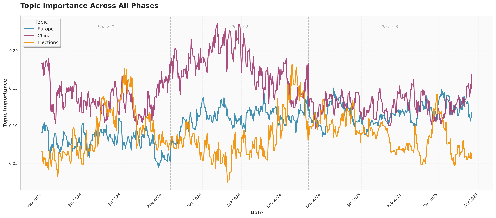
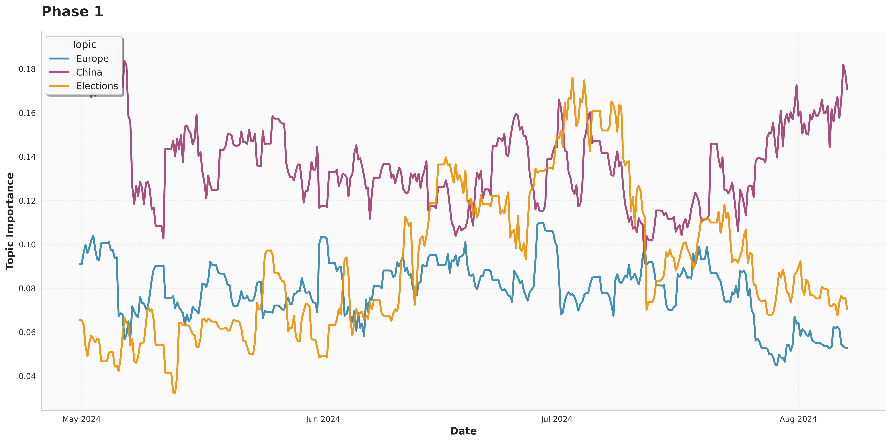
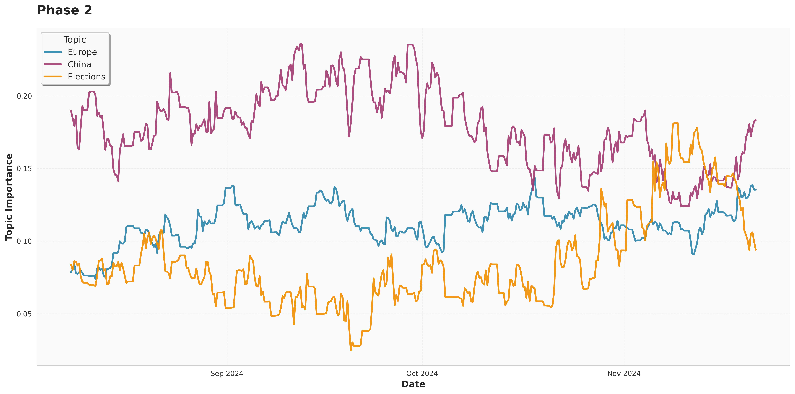
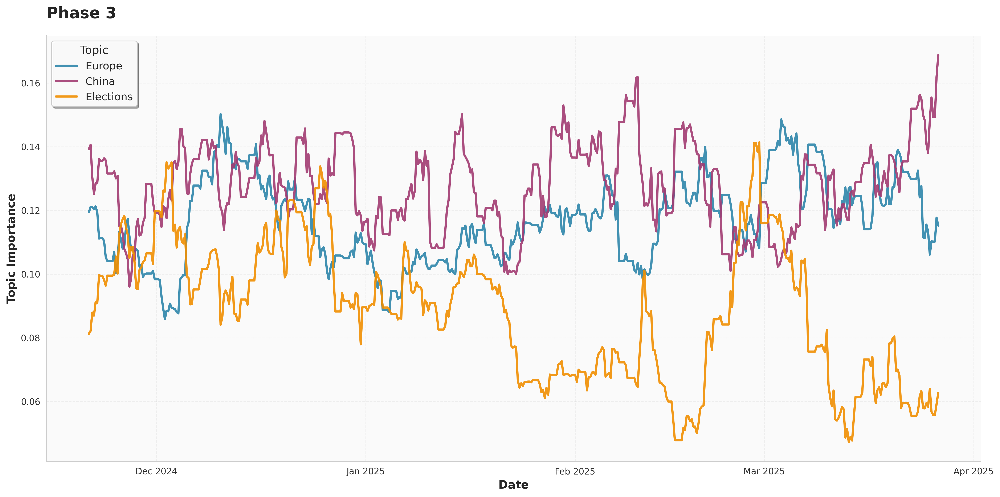

# Contrastive Legitimacy Framing in Ethnic Chinese Media

Code and topic-model results for:

> **TODO: Authors** (2026). Shaping Opinions Across Borders: Contrastive Legitimacy Framing of 2024–25 European Elections in Ethnic Chinese Media. *Global Media and Communication*. https://doi.org/TODO

The article examines how *Nouvelles d'Europe* (欧洲时报, NE), Europe's largest Chinese-language newspaper and one with close institutional ties to the Chinese Party-state, covered the cycle of liberal-democratic elections in Europe between April 2024 and February 2025. We collected NE's online output every six hours, used dynamic topic modelling to map what the paper wrote about and when, and then carried out qualitative framing analysis of the election coverage. Across the European Parliament election, the French, Austrian and German state elections, and the German federal election, NE presented liberal-democratic governance as unstable and dysfunctional while normalising sovereignty-oriented actors. We call this pattern *contrastive legitimacy framing*.

This repository contains the computational part of that workflow: the scripts that turned scraped HTML into a text corpus, embedded it, and fitted the KeyNMF topic models, together with the figures and the document-level topic distributions that came out of them. The qualitative coding (done in MAXQDA) and the article texts themselves are not included; see [Data availability](#data-availability).

---

## Main result



**Topic importance over time** (Figure 2 in the article). Importance is the share of documents in each six-hourly snapshot for which a topic is the primary topic assignment. The lines are clusters of related topics from the 10-topic KeyNMF model, grouped into *Europe*, *China* and *Elections*. Dashed lines mark the boundaries between the three data-collection phases.

Topics concerning China and the Chinese leadership dominate for most of the period, but European affairs take up a comparable and at times larger share of coverage, particularly from late 2024 onwards. Election coverage peaks around the European Parliament and French legislative elections (June–July 2024), again in November 2024, and around the German federal election in late February 2025.

<details>
<summary><strong>Each phase separately</strong></summary>

| Phase | Approximate window |
|---|---|
| 1 | 30 April – early August 2024 |
| 2 | early August – 21 November 2024 |
| 3 | 21 November 2024 – late March 2025 |







</details>

---

## Repository structure

```
.
├── README.md
├── CITATION.cff
├── LICENSE                         MIT, for the code in src/
├── requirements.txt                Python dependencies used by the scripts (unpinned)
├── docs/
│   ├── pipeline.md                 What each script does, its inputs and outputs, and the expected DATA/ layout
│   ├── data.md                     What is and isn't released, file formats, column dictionary
│   └── topics.md                   Topic labels (Chinese, with English glosses) for the 10- and 20-topic models
├── results/
│   ├── figures/                    Topic importance over time (all phases, and per phase)
│   └── topic_models/
│       └── oushinet_phase3/
│           ├── 10_topics/          Document–topic distributions + topic labels (model used in the article)
│           └── 20_topics/          Same for 20 topics + interactive topics-over-time plot (HTML)
└── src/                            Analysis scripts, as used for the article
    ├── *-com.py, chinanews-se.py   Parse scraped HTML into per-site CSV corpora
    ├── embeddings.py               Sentence-transformer document embeddings
    ├── run_turftopic10.py / 20.py  Dynamic KeyNMF topic models
    ├── extract_doc_topics.py       Document–topic distributions
    ├── gather_topic_info.py        Per-snapshot topic summaries (Excel)
    ├── create_dataset_figures.py   Corpus descriptives
    ├── run_news_fluxus.py, smoothing.py, figures.py
    │                               Novelty/resonance analysis (exploratory; not reported in the article)
    └── newsFluxus/                 Vendored copy of centre-for-humanities-computing/newsFluxus (MIT)
```

The scripts are kept as they were run. They expect to be executed from inside `src/` with a sibling `DATA/` directory at the repository root (git-ignored). [docs/pipeline.md](docs/pipeline.md) documents that layout and the order in which the scripts were run.

---

## Method in brief

1. **Collection.** All articles linked from the front page and relevant subpages of [oushinet.com](https://www.oushinet.com) were scraped every six hours between 30 April 2024 and 28 February 2025 using a custom-built web server. The same infrastructure collected four other Chinese-language outlets; the parsing scripts for these are included here, but the article itself is restricted to NE.
2. **Parsing.** Article titles and body text were extracted from the HTML (`oushinet-com.py`), and duplicate articles within a snapshot were discarded.
3. **Embedding.** Documents were embedded with the multilingual sentence transformer [`paraphrase-multilingual-MiniLM-L12-v2`](https://huggingface.co/sentence-transformers/paraphrase-multilingual-MiniLM-L12-v2) (`embeddings.py`).
4. **Topic modelling.** A dynamic [KeyNMF](https://x-tabdeveloping.github.io/turftopic/KeyNMF/) model with 10 topics was fitted using [turftopic](https://github.com/x-tabdeveloping/turftopic), with each six-hourly snapshot as a time bin (`run_turftopic10.py`). Candidate keywords were taken from a [jieba](https://github.com/fxsjy/jieba)-segmented vocabulary with [stopwords-zh](https://github.com/stopwords-iso/stopwords-zh) removed. The choice of 10 topics and the model's robustness to the number of keywords follow Kristensen-McLachlan et al. (2024); see Appendix A of the article.
5. **Qualitative analysis.** Articles in election-related topics were coded in MAXQDA using Entman's framing framework (n = 73 European Parliament, 89 French/Austrian/German state, 83 German federal entries). The coding is not part of this repository.

---

## Results

| File | Contents |
|---|---|
| [`results/figures/`](results/figures) | Topic importance over time, as PNG |
| [`results/topic_models/oushinet_phase3/10_topics/topic_labels_10.csv`](results/topic_models/oushinet_phase3/10_topics/topic_labels_10.csv) | The 10 topics: top terms, English gloss, share of articles for which each is the primary topic |
| [`results/topic_models/oushinet_phase3/10_topics/doc_topic_distributions_10.csv.gz`](results/topic_models/oushinet_phase3/10_topics) | Topic weights for every article in every snapshot, phase 3 (84,523 rows; 5,390 unique articles; 504 snapshots) |
| [`results/topic_models/oushinet_phase3/20_topics/`](results/topic_models/oushinet_phase3/20_topics) | The same for a 20-topic model, plus `topics_over_time_20.html` |

[docs/topics.md](docs/topics.md) lists all topics with glosses. [docs/data.md](docs/data.md) has the column dictionary.

The HTML file is a self-contained interactive Plotly chart of topic keywords and importance over time. GitHub shows HTML as source, so download it and open it in a browser.

---

## Data availability

The article texts are © *Nouvelles d'Europe* and are not redistributed here. The released results identify articles by NE's own article ID and snapshot timestamp, and contain no title or body text. The raw scrape, parsed corpus, embeddings and MAXQDA project are stored on secure, GDPR-compliant infrastructure (UCloud) at Aarhus University. Researchers who want access for verification should contact the authors. See [docs/data.md](docs/data.md) for details.

---

## Related software and work

- Kristensen-McLachlan, R. D., Hicke, R. M. M., Kardos, M., & Thunø, M. (2024). Context is Key(NMF): Modelling Topical Information Dynamics in Chinese Diaspora Media. *Computational Humanities Research 2024*, Aarhus.
- Kardos, M., Enevoldsen, K. C., Kostkan, J., Kristensen-McLachlan, R. D., & Rocca, R. (2025). Turftopic: Topic Modelling with Contextual Representations from Sentence Transformers. *Journal of Open Source Software*, 10(111), 8183.
- [newsFluxus](https://github.com/centre-for-humanities-computing/newsFluxus), Center for Humanities Computing, Aarhus University (MIT licence; vendored in `src/newsFluxus/`).

---

## Citation

If you use this code or these results, please cite the article. GitHub's **Cite this repository** button uses [`CITATION.cff`](CITATION.cff).

```bibtex
@article{TODO_2026_contrastive,
  author  = {TODO},
  title   = {Shaping Opinions Across Borders: Contrastive Legitimacy Framing of 2024--25 European Elections in Ethnic Chinese Media},
  journal = {Global Media and Communication},
  year    = {2026},
  doi     = {TODO}
}
```

## Licence

The code in `src/` is released under the [MIT licence](LICENSE), except `src/newsFluxus/`, which keeps its original MIT licence (© 2020 Aarhus University, Center for Humanities Computing). The derived results in `results/` are released under [CC BY 4.0](https://creativecommons.org/licenses/by/4.0/).
